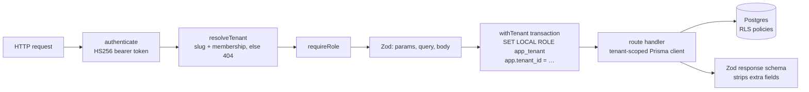

# tenant-guard-api

[](https://github.com/hdamasceno/tenant-guard-api/actions/workflows/ci.yml)


A multi-tenant REST API (schools → courses, students, enrolments) that shows how to make
**cross-tenant data leaks hard to write by accident**. Isolation is enforced in three
independent layers, and the test suite attacks each of them.

> All schools, people and data are invented.

## The three layers

| Layer | What it does | What it catches |
| --- | --- | --- |
| **1. Prisma client extension** (`src/db/tenant.ts`) | Every query on a tenant-owned model gets `tenantId` added to its filter, creates get it stamped in, and naming a different tenant throws `TenantViolationError`. Global models are refused, so code must reach for the unscoped client on purpose. | A handler that forgets `where: { tenantId }`. |
| **2. Postgres row-level security** (`prisma/migrations/*_row_level_security`) | Each request runs in a transaction that does `SET LOCAL ROLE app_tenant` and sets `app.tenant_id`. Policies on every tenant table allow only that tenant's rows, for reads and writes. | Raw SQL, a bug in layer 1, or a future code path that skips it. |
| **3. Composite foreign keys** (`prisma/schema.prisma`) | Tenant-owned rows relate through `(tenantId, id)`, not just `id`. | Linking a student of school A to a course of school B, even from an admin script. |

Around them:

- **Tenant resolution answers 404, never 403**, for a school that does not exist *and* for one
  you are not a member of. Ids and slugs from other tenants cannot be probed.
- **Strict input schemas** reject unknown keys, so a body cannot carry its own `tenantId`.
- **Output schemas strip** anything not declared, so internal fields never reach a client.
- **Roles are ordered** (`VIEWER < STAFF < OWNER`) and declared per route.
- **No overbooking under load.** Enrolment locks the course row (`SELECT … FOR UPDATE`) inside
  the tenant transaction; a test fires 8 concurrent enrolments at a 3-seat course and expects
  exactly 3 successes.

## Typed routes, one source of truth

Each endpoint is one declaration. The same object mounts the Express handler, validates params,
query and body with Zod, validates (and strips) the response, and generates the **OpenAPI 3.1**
document at `/openapi.json`, so the docs cannot drift from the code.

```ts
route({
  method: 'post',
  path: '/courses/:courseId/enrollments',
  summary: 'Enrol a student; fails when the course is full',
  minRole: 'STAFF',
  params: CourseParams,
  body: EnrollmentCreate,
  response: Enrollment,
  status: 201,
  errors: [[404, 'student_not_found'], [409, 'course_full'], [409, 'already_enrolled']],
  handler: async ({ db, tenant, params, body }) => { /* db is already tenant-scoped */ },
});
```

## Architecture



```
src/
├── db/
│   ├── client.ts          PrismaClient with the pg driver adapter
│   └── tenant.ts          tenantScope() extension and withTenant()
├── auth/tokens.ts         sign/verify access tokens (jose, HS256, issuer + audience checked)
├── http/
│   ├── app.ts             Express app, /health, /me, /openapi.json, error mapping
│   ├── route.ts           route() + mountRoutes(): typed, validated endpoints
│   ├── openapi.ts         OpenAPI 3.1 from the route table and Zod schemas
│   ├── schemas.ts         every request/response schema
│   ├── middleware/        authenticate, resolveTenant, requireRole
│   └── routes/            courses, students, enrollments
├── env.ts                 environment validated at startup
└── server.ts
prisma/
├── schema.prisma          composite tenant keys
├── migrations/            init + row-level security
└── seed.ts                invented demo data
```

## Run it

Requires Node 22.12+ and Docker.

```bash
cp .env.example .env
npm install
npm run db:up
npm run db:migrate
npm run db:seed
npm run dev
```

```bash
TOKEN=$(npm run -s token -- max@both.example)
curl -s -H "Authorization: Bearer $TOKEN" localhost:3000/me
```

A session against the seeded data looks like this:

```text
$ curl -s -H "Authorization: Bearer $TOKEN" localhost:3000/me
{"id":"…","email":"max@both.example","name":"Max Multi","tenants":[
  {"slug":"harbor-college","name":"Harbor College","role":"STAFF"},
  {"slug":"ridge-institute","name":"Ridge Institute","role":"OWNER"}]}

$ curl -s -H "Authorization: Bearer $TOKEN" "localhost:3000/t/ridge-institute/courses?limit=1"
{"items":[{"id":"…","code":"ART-110","title":"Drawing I","capacity":12,"enrolled":0,
  "createdAt":"…"}],"nextCursor":"…"}

$ curl -s -o /dev/null -w "%{http_code}\n" -H "Authorization: Bearer $VERA" \
    localhost:3000/t/harbor-college/courses      # Vera only belongs to Ridge
404
```

The OpenAPI document is at `http://localhost:3000/openapi.json`; load it into any OpenAPI viewer.

## Test it

| Command | What it runs |
| --- | --- |
| `npm run lint` | ESLint with `typescript-eslint` **strict type-checked** rules, zero warnings |
| `npm run typecheck` | `tsc --noEmit` with `strict`, `noUncheckedIndexedAccess`, `verbatimModuleSyntax` |
| `npm test` | 39 Vitest integration tests against a **real Postgres** (a separate `_test` database, migrated automatically) |
| `npm run coverage` | the same, with coverage |
| `npm run check:secrets` | secret scan of the staged files (`-- --all` for every tracked file) |
| `npm run test:hooks` | tests for the secret scanner (`node --test`) |

What the tests cover:

- **Isolation, layer by layer**: the extension alone, RLS alone (raw SQL inside a tenant
  transaction, a raw insert into another tenant, no tenant set at all, writes to global tables),
  and the composite keys alone.
- **Attacks over HTTP**: reading, updating, deleting and enrolling across tenants with real ids;
  a body that tries to set `tenantId`; responses checked for leaked tenant ids.
- **Auth**: missing, malformed, forged and expired tokens; ordered roles.
- **Behaviour**: cursor pagination, per-tenant uniqueness, capacity rules, cascades, and the
  concurrent overbooking race.
- **Docs**: every route is documented, every path placeholder is declared, every `$ref` resolves.

CI runs a secret scan, then starts a Postgres service container and runs lint, typecheck, build, migrations and the full
suite on every push and pull request.

### Git hooks

`npm install` sets up [Husky](https://typicode.github.io/husky/) hooks, so the checks CI runs
also run locally, before anything leaves your machine:

| Hook | Runs | Why |
| --- | --- | --- |
| `pre-commit` | secret scan, then lint, then typecheck | stop private keys, tokens and `.env` files before they are in history |
| `pre-push` | `db:up` (starts the Docker Postgres if needed), then the 39 integration tests: HTTP through Express into Postgres with RLS, this API's end-to-end layer | do not push a branch that CI will reject |

The secret scan (`scripts/check-secrets.mjs`, no dependencies) blocks `.env` files (except
`.env.example`), key and certificate files (`.pem`, `.key`, `.p8`, `.p12`, `.jks`, SSH keys), and
content that looks like a private key, cloud or API token, or a connection string with a password
for a non-local host. It only reads the staged version of each file and never prints the value it
found. If [gitleaks](https://github.com/gitleaks/gitleaks) is installed it runs too, as a second
opinion. A false positive can be allowed with a `secret-scan: allow` comment on that line.

In an emergency `git commit --no-verify` skips the hooks; CI still runs the same secret scan, plus
gitleaks over the full history, on every push and pull request.

## Not included, on purpose

- **Login and user management.** Tokens come from `npm run token` for seeded users; a real system
  would put an identity provider in front.
- **Rate limiting and an HTTP security-headers package.** The app sets `nosniff` and
  `no-store` and hides `x-powered-by`; a gateway would normally do the rest.
- **Connection-pool tuning.** One transaction per tenant request is simple and safe; at high load
  you would size the pool, or set the tenant per statement instead.

## License

[MIT](LICENSE) © Henry Lima
